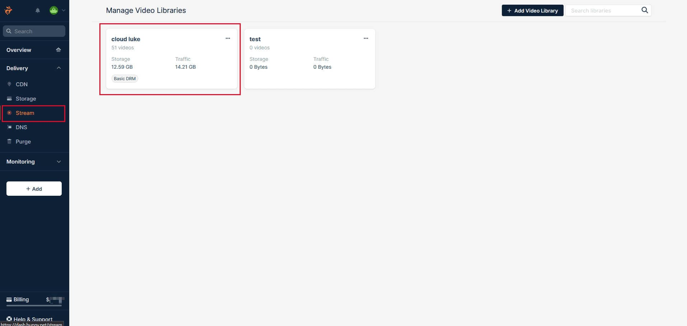
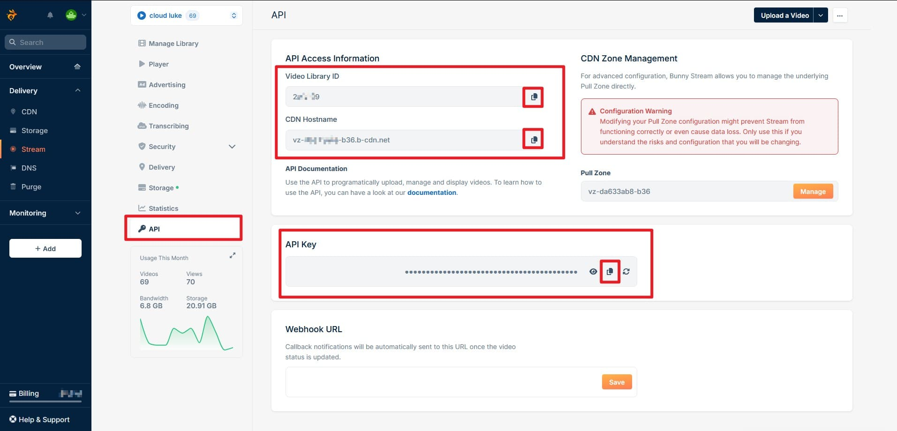

# Power Course — WordPress LMS Plugin

[繁體中文](./README.zh-TW.md) | English | [MCP Integration](./mcp.md)

[](https://github.com/zenbuapps/wp-power-course/releases)
[](https://www.php.net/)
[](https://wordpress.org/)
[](https://woocommerce.com/)
[](./LICENSE)

> A full-featured LMS plugin for WordPress + WooCommerce — sell and manage online courses with a modern React admin interface.

---

## Overview

Power Course transforms WooCommerce products into online courses with hierarchical chapters, video streaming, progress tracking, and automated email workflows — all managed through a React SPA admin dashboard backed by a RESTful API.

---

## Features

### Course Management
- Create, update, delete, and duplicate courses
- Courses are built on WooCommerce products — pricing, stock, and checkout flow are handled natively
- Filter and search course listings
- Set course visibility and launch schedule (scheduled start date triggers automatic notifications)

### Chapter Management
- Hierarchical chapter / unit structure with unlimited nesting
- Drag-and-drop reordering (sort chapters via API)
- Upload and delete subtitle files (`.srt`) per chapter
- Per-chapter completion toggle tracked per student

### Student Management
- Enroll students into a course manually or in bulk (CSV import)
- Remove student course access
- Update individual student expiry dates
- View student list with search and pagination
- Export student list to CSV
- View per-student activity logs (chapter visits, completions, access events)

### Progress Tracking
- Toggle chapter completion status per student
- Course progress calculated as a percentage (0–100%) based on completed chapters
- Triggers `power_course_course_finished` action when 100% is reached

### Access Control
| Type | Description |
|------|-------------|
| Unlimited | No expiry |
| Fixed duration | N days from enrollment |
| Specific date | Access until a set date |
| Subscription | Follows WooCommerce Subscription lifecycle |

### Bundle Products (Sales Plans)
- Group multiple products into a bundle that grants access to linked courses on purchase
- Display bundle item quantities in the product listing
- Bundles cannot contain other bundles

### Automated Email (PowerEmail)
- Drag-and-drop MJML-based email builder
- 5 trigger events:

| Trigger | When Fired |
|---------|-----------|
| `course_granted` | Student gains course access |
| `course_finish` | Student reaches 100% completion |
| `course_launch` | Scheduled course launch date is reached |
| `chapter_enter` | Student first enters a chapter |
| `chapter_finish` | Student marks a chapter as complete |

- Variable replacement: `{user.display_name}`, `{user.email}`, `{course.title}`, `{chapter.title}`, and more
- Create, update, and delete email templates
- Automatic email send history stored in database

### WooCommerce Integration
- Auto-activate course access when an order reaches the configured status (default: `completed`)
- Prevent guest checkout for course products
- Bind multiple courses to a single WooCommerce product
- Scheduled course start notifications dispatched via Action Scheduler

### Teacher Management
- Assign one or more instructors to a course
- Dedicated teacher management interface in the admin panel

### Analytics & Reports
- Revenue reports per course / date range
- Course completion rate statistics
- Student activity log with filterable event types

### Media & Watermarking
- Upload media files (video, images, PDFs) through the admin
- Dynamic video watermark overlay (user info — display name, email, etc.)
- PDF watermark support
- Configurable watermark count and template text

### Video Playback
- **Bunny Stream** (HLS adaptive streaming) — primary CDN
- **YouTube** embed
- **Vimeo** embed
- Custom embed code support
- Sticky video player and tab navigation on mobile

### Subtitles
- Upload `.srt` subtitle files per chapter
- Delete subtitles
- Default empty subtitle option (no subtitle selected by default)

---

## Requirements

| Dependency | Minimum Version | Source |
|-----------|----------------|--------|
| WordPress | 5.7 | [wordpress.org](https://wordpress.org/) |
| PHP | 8.0 | |
| WooCommerce | 7.6.0 | [wordpress.org/plugins/woocommerce](https://wordpress.org/plugins/woocommerce/) |
| [Powerhouse](https://github.com/zenbuapps/wp-powerhouse) | 3.3.41 | GitHub |

**Optional:**
- WooCommerce Subscriptions — required for subscription-based access control

---

## Installation

### Production

1. Download the latest `.zip` from [GitHub Releases](https://github.com/zenbuapps/wp-power-course/releases)
2. In WordPress Admin go to **Plugins → Add New → Upload Plugin**
3. Install and activate **WooCommerce** and **Powerhouse** first
4. Install and activate **Power Course**
5. The plugin automatically creates 4 required database tables on activation

### Development

```bash
# PHP dependencies
composer install

# JS dependencies
pnpm install

# Start Vite dev server (port 5174)
pnpm run dev

# Production build
pnpm run build
```

---

## Architecture

### Tech Stack

| Layer | Technology |
|-------|-----------|
| Backend language | PHP 8.0+, `declare(strict_types=1)` |
| Backend framework | WordPress, WooCommerce 7.6.0+, Powerhouse 3.3.41+ |
| PHP namespace | `J7\PowerCourse` (PSR-4: `inc/classes/`, `inc/src/`) |
| Frontend language | TypeScript 5.5 (strict mode) |
| Frontend framework | React 18, Refine.dev 4.x, Ant Design 5.x |
| State management | Jotai (UI state), TanStack Query 4.x (server state) |
| Build tool | Vite + @kucrut/vite-for-wp |
| Video player | VidStack, hls.js, Bunny CDN |
| Email editor | j7-easy-email (MJML-based) |
| Testing | Playwright E2E, PHPUnit |
| PHP quality | PHPCS (WordPress standards) + PHPStan level 9 |
| TS quality | ESLint + Prettier |

### Directory Structure

```
power-course/
├── plugin.php              # Plugin entry point (Singleton)
├── inc/                    # PHP backend
│   ├── classes/            # PSR-4 autoload
│   │   ├── Api/            # REST API endpoints
│   │   ├── Resources/      # Domain resources (Course, Chapter, Student…)
│   │   ├── BundleProduct/  # Bundle / sales plan logic
│   │   ├── PowerEmail/     # Automated email subsystem
│   │   └── Utils/          # Utility classes
│   ├── src/Domain/         # DDD-style: Product Events
│   └── templates/          # PHP frontend templates
├── js/src/                 # React admin SPA
│   ├── pages/admin/        # Admin pages (lazy-loaded)
│   ├── components/         # Reusable components
│   ├── hooks/              # Custom React hooks
│   ├── resources/          # Refine.dev resource definitions
│   └── types/              # TypeScript type definitions
├── tests/e2e/              # Playwright E2E tests
└── specs/                  # Business specification documents
```

### Custom Database Tables

| Table | Purpose |
|-------|---------|
| `{prefix}_pc_avl_coursemeta` | User ↔ Course metadata (expiry, progress) |
| `{prefix}_pc_avl_chaptermeta` | User ↔ Chapter progress |
| `{prefix}_pc_email_records` | Automated email send history |
| `{prefix}_pc_student_logs` | Student activity audit trail |

### Custom Post Type

| CPT | Slug | Description |
|-----|------|-------------|
| `pc_chapter` | `classroom` | Course chapters (hierarchical) |

---

## REST API

Base URL: `{site_url}/wp-json/power-course/v2/`

| Endpoint | Methods | Description |
|----------|---------|-------------|
| `courses` | GET, POST, DELETE | List / create / bulk-delete courses |
| `courses/{id}` | GET, POST, DELETE | Get / update / delete a course |
| `courses/add-students` | POST | Enroll students into a course |
| `courses/remove-students` | POST | Revoke student course access |
| `courses/update-students` | POST | Update student expiry dates |
| `courses/student-logs` | GET | Student activity logs |
| `chapters` | GET, POST, DELETE | List / create / bulk-delete chapters |
| `chapters/{id}` | POST | Update a chapter |
| `chapters/sort` | POST | Reorder chapters |
| `chapters/{id}/subtitles` | POST, DELETE | Upload / delete subtitle file |
| `toggle-finish-chapters/{id}` | POST | Toggle chapter completion |
| `products` | GET | List WooCommerce products |
| `bundle-products` | GET, POST | Manage bundle products |
| `teachers` | GET, POST | Manage teacher assignments |
| `options` | GET, POST | Plugin settings |
| `reports/revenue` | GET | Revenue analytics |
| `comments` | GET, POST | Chapter comments |
| `media` | POST | Upload media files |

Full OpenAPI 3.0.3 specification: [`specs/api/api.yml`](./specs/api/api.yml)

---

## WordPress Hooks

### Actions

```php
// After course access is granted to a student
add_action(
    'power_course_after_add_student_to_course',
    function( int $user_id, int $course_id, int|string $expire_date, ?\WC_Order $order ) {
        // send custom notification, award points, etc.
    },
    10, 4
);

// When a student reaches 100% course completion
add_action(
    'power_course_course_finished',
    function( int $course_id, int $user_id ) {
        // issue certificate, etc.
    },
    10, 2
);

// Before course / chapter meta is saved via REST API
add_action(
    'power_course_before_update_product_meta',
    function( \WC_Product $product, array $meta_data ) {
        // validate or modify meta data before save
    },
    10, 2
);
```

### Granting Course Access Programmatically

```php
use J7\PowerCourse\Resources\Course\LifeCycle;

// Always dispatch the action — never call the underlying function directly
do_action(
    LifeCycle::ADD_STUDENT_TO_COURSE_ACTION,
    $user_id,      // int   — WordPress user ID
    $course_id,    // int   — WooCommerce product ID
    $expire_date,  // 0 = unlimited | Unix timestamp | 'subscription_123'
    $order         // \WC_Order|null
);
```

### Utility Functions

```php
use J7\PowerCourse\Utils\Course as CourseUtils;

CourseUtils::is_course_product( $product );          // bool — is this a course?
CourseUtils::is_avl( $course_id, $user_id );         // bool — does user have access?
CourseUtils::is_course_ready( $product );             // bool — has it launched?
CourseUtils::is_expired( $product, $user_id );       // bool — has access expired?
CourseUtils::get_course_progress( $product, $user_id ); // float 0–100
```

---

## Plugin Settings

Go to **WordPress admin → Power Course → Settings**. The settings page has several tabs:

| Tab | Field name on screen | What it does |
|-----|----------------------|--------------|
| General settings | Trigger course access when the order reaches this status | When a student's order reaches this status, the course is unlocked automatically (default: Completed) |
| General settings | Require comment moderation | When on, whether comments / reviews need approval follows WordPress **Settings → Discussion**; when off, they are published immediately |
| General settings | Classroom video watermark settings > Watermark count | Enter 0 to show no watermark |
| General settings | Classroom video watermark settings > Watermark text | Text shown on the watermark; supports variables such as `{display_name}`, `{email}`, `{ip}`, `{username}`, `{post_title}` |
| General settings | Course material PDF watermark settings > Watermark count | Enter 0 to add no watermark to PDFs |
| General settings | Extend the permalink structure of the course sales page | e.g. enter `courses` so `courses/{slug}` also shows the course sales page |
| Appearance settings | Sticky video and tabs on mobile | On phones, the video / tabs stick to the top of the sales page (you can also stick only the tabs or only the video) |
| Appearance settings | Purchase button text | Site-wide default purchase button text; each course can override it |
| Appearance settings | Hide My Courses menu in My Account | Hide it while your courses are not ready yet |
| Appearance settings | Hide course products on shop page / Hide course products in search results | Keep courses out of the WooCommerce shop page or site search results |
| Auto-grant | (course list) | Unlock the selected courses as soon as a user registers |

> Developers can use the REST API `GET` / `POST /wp-json/power-course/settings` instead (the old `/options` route is a deprecated alias); see the `Settings` schema in `specs/api/api.yml` for field names.

### Connecting Bunny Stream (video hosting)

The 3 Bunny keys are **entered in Power Course**, not on the Powerhouse settings page.

> The Bunny dashboard menu names below reflect the dashboard at the time of writing. If Bunny changes its UI, follow what your Bunny dashboard shows.

**Step 1: Find your video library in Bunny**

1. Log in to the Bunny dashboard at https://dash.bunny.net
2. Click **Stream** in the left menu
3. Click the card of the video library you want to use
   (no video library yet? Click **+ Add Video Library** at the top right to create one)



**Step 2: Copy 3 values**

1. In the video library's left menu, click **API**
2. Use the copy icon on the right of each box to copy these 3 values:
   - **Video Library ID** (a number)
   - **CDN Hostname** (looks like `vz-xxxxxxxx-xxx.b-cdn.net`)
   - The key in the **API Key** section below (use this video library's API Key, not the Account API Key from your account settings)



**Step 3: Paste them into Power Course**

1. Go to **WordPress admin → Power Course → Bunny media library**
2. Click the **Bunny Settings** tab at the top (if Bunny is not set up yet, the Bunny media library opens on this tab)
3. Paste the values as shown below, click **Save**, then reload the page:

| Name in the Bunny dashboard | Power Course field |
|-----------------------------|--------------------|
| Video Library ID | Bunny Library ID |
| CDN Hostname | Bunny CDN Hostname |
| API Key | Bunny Stream API Key |

Go back to the Bunny media library tab — if you can see your video list, the connection works.

> If videos play but the watermark does not show, the video library usually has DRM turned on. See the instructions on the right of **Power Course → Settings → General settings** to turn it off.

---

## MCP Server (AI Agent Integration)

Power Course includes a [Model Context Protocol (MCP)](https://modelcontextprotocol.io/) server that allows AI agents (Claude Code, Cursor, GPT, etc.) to manage your LMS through natural language — creating courses, enrolling students, querying reports, and more.

**41 tools across 9 domains**: Course, Chapter, Student, Teacher, Bundle, Order, Progress, Comment, Report.

For setup instructions and full tool reference, see the **[MCP Setup Guide](./mcp.md)**.

---

## Development

### Commands

```bash
# Development
pnpm run dev              # Vite dev server (http://localhost:5174)
pnpm run build            # i18n:build + Production JS build
pnpm run build:wp         # WordPress-optimized build

# Quality checks
pnpm run lint:php         # PHPCS + PHPStan
pnpm run lint:ts          # ESLint
pnpm run format           # Prettier-ESLint format
composer run phpstan      # PHPStan static analysis (level 9)

# Testing
composer run test             # PHPUnit
pnpm run test:e2e             # All Playwright E2E tests
pnpm run test:e2e:admin       # Admin-side E2E
pnpm run test:e2e:frontend    # Frontend E2E
pnpm run test:e2e:integration # Integration E2E

# Internationalization (i18n)
pnpm run i18n:pot         # Scan PHP + JS and generate .pot file
pnpm run i18n:mo          # Compile .po → .mo (PHP runtime)
pnpm run i18n:json        # Compile .po → JED JSON (React runtime)
pnpm run i18n:build       # Run all three i18n commands above

# Release
pnpm run release          # Bump patch version + build + release
pnpm run release:minor    # Bump minor version
pnpm run release:major    # Bump major version
pnpm run zip              # Create distributable plugin zip
pnpm run sync:version     # Sync version: package.json → plugin.php
```

### Code Standards

- **PHP**: WordPress Coding Standards (WPCS), PHPStan level 9 (`phpstan.neon`)
- **TypeScript**: ESLint with strict mode
- **Formatting**: Prettier (tabs, single quotes, no semicolons)
- **Commits**: Conventional Commits (`feat:`, `fix:`, `chore:`, etc.)

---

## Contributing

1. Fork the repository
2. Create a feature branch: `git checkout -b feat/my-feature`
3. Follow the coding standards above
4. Ensure all tests pass: `pnpm run test:e2e` and `composer run test`
5. Open a Pull Request against `master`

---

## License

GPL v2 or later — see [LICENSE](./LICENSE) for details.

---

## Links

- [GitHub Repository](https://github.com/zenbuapps/wp-power-course)
- [Author](https://github.com/j7-dev)
- [Powerhouse Plugin](https://github.com/zenbuapps/wp-powerhouse)
- [API Specification](./specs/api/api.yml)
- [WordPress Developer Reference](https://developer.wordpress.org/reference/)
- [WooCommerce Code Reference](https://woocommerce.github.io/code-reference/)
- [Refine.dev Documentation](https://refine.dev/docs/)
