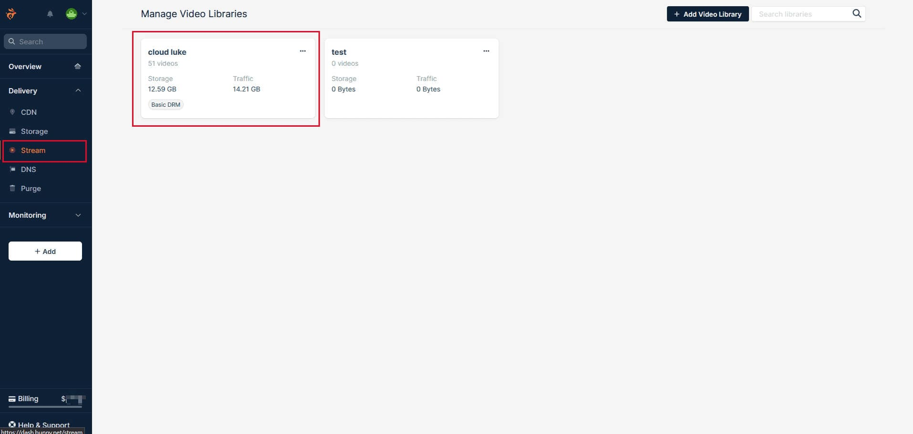
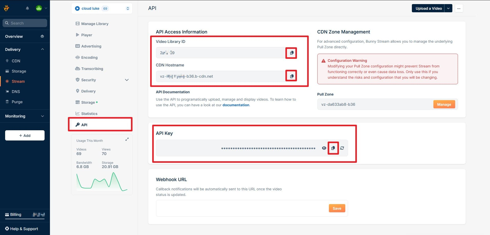

# Power Course — WordPress 課程外掛

[English](./README.md) | 繁體中文 | [MCP 整合說明](./mcp.zh-TW.md)

[](https://github.com/zenbuapps/wp-power-course/releases)
[](https://www.php.net/)
[](https://wordpress.org/)
[](https://woocommerce.com/)
[](./LICENSE)

> WordPress 最好用的課程外掛 — 透過 WooCommerce 銷售與管理線上課程，配備現代化 React 管理介面。

---

## 概覽

Power Course 將 WooCommerce 商品轉化為線上課程，提供階層式章節管理、視訊串流、學習進度追蹤與自動化郵件流程，全部透過以 RESTful API 驅動的 React SPA 後台管理。

---

## 功能特色

### 課程管理
- 建立、更新、刪除、複製課程
- 課程基於 WooCommerce 商品構建 — 定價、庫存與結帳流程原生支援
- 課程列表篩選與搜尋
- 設定課程可見性與開課時程（開課日期到達時自動發送通知）

### 章節管理
- 無限層級的章節 / 單元結構
- 拖曳排序（透過 API 更新章節順序）
- 每章節可上傳、刪除 `.srt` 字幕檔
- 每位學員的章節完成狀態獨立追蹤

### 學員管理
- 手動或批次（CSV 匯入）加入學員至課程
- 移除學員課程存取權限
- 更新個別學員到期日
- 學員列表搜尋與分頁
- 匯出學員列表為 CSV
- 查看每位學員的活動紀錄（進章、完成、存取事件）

### 學習進度追蹤
- 每位學員可獨立切換章節完成狀態
- 課程進度以百分比呈現（0–100%），依完成章節數計算
- 進度達 100% 時觸發 `power_course_course_finished` 動作鉤

### 存取控制
| 類型 | 說明 |
|------|------|
| 無限期 | 無到期時間 |
| 固定天數 | 加入後 N 天到期 |
| 指定日期 | 存取至指定日期為止 |
| 訂閱制 | 跟隨 WooCommerce Subscription 生命週期 |

### 銷售方案（Bundle Products）
- 將多個商品組合為銷售方案，購買後授予所有連結課程的存取權
- 在商品列表中顯示方案內的商品數量
- 銷售方案不可包含其他銷售方案

### 自動化郵件（PowerEmail）
- 基於 MJML 的拖曳式郵件編輯器
- 5 個觸發事件：

| 觸發點 | 觸發時機 |
|--------|---------|
| `course_granted` | 學員獲得課程存取權 |
| `course_finish` | 學員完成 100% 課程 |
| `course_launch` | 預定開課日期到達 |
| `chapter_enter` | 學員首次進入章節 |
| `chapter_finish` | 學員標記章節完成 |

- 支援變數替換：`{user.display_name}`、`{user.email}`、`{course.title}`、`{chapter.title}` 等
- 可建立、更新、刪除郵件模板
- 自動記錄郵件發送歷史至資料庫

### WooCommerce 整合
- 訂單達到指定狀態（預設：`completed`）時自動開通課程存取
- 課程商品防止訪客結帳
- 將多門課程綁定至單一 WooCommerce 商品
- 透過 Action Scheduler 排程發送開課通知

### 講師管理
- 將一位或多位講師指派至課程
- 後台專屬講師管理介面

### 數據分析與報表
- 依課程 / 日期範圍查詢營收報表
- 課程完成率統計
- 可篩選的學員活動日誌

### 媒體上傳與浮水印
- 透過後台上傳媒體檔案（影片、圖片、PDF）
- 動態影片浮水印（覆蓋用戶資訊：名稱、信箱等）
- PDF 浮水印支援
- 可設定浮水印數量與樣板文字

### 視訊播放
- **Bunny Stream**（HLS 自適應串流）— 主要 CDN
- **YouTube** 嵌入
- **Vimeo** 嵌入
- 自訂嵌入碼
- 行動裝置上的固定視訊播放器與頁籤導覽

[](https://docs.google.com/spreadsheets/d/1mib3g3LLEl31GK11PMq8ozkQpFFMx8c_qss8UChW0j4/edit?gid=0#gid=0)


### 字幕
- 每章節可上傳 `.srt` 字幕檔
- 刪除字幕
- 支援預設空字幕選項（預設不顯示字幕）

---

## 系統需求

| 相依套件 | 最低版本 | 來源 |
|---------|---------|------|
| WordPress | 5.7 | [wordpress.org](https://wordpress.org/) |
| PHP | 8.0 | |
| WooCommerce | 7.6.0 | [wordpress.org/plugins/woocommerce](https://wordpress.org/plugins/woocommerce/) |
| [Powerhouse](https://github.com/zenbuapps/wp-powerhouse) | 3.3.41 | GitHub |

**選用：**
- WooCommerce Subscriptions — 訂閱制存取控制所需

---

## 安裝方式

### 正式環境

1. 從 [GitHub Releases](https://github.com/zenbuapps/wp-power-course/releases) 下載最新 `.zip`
2. 進入 **WordPress 後台 → 外掛 → 新增外掛 → 上傳外掛**
3. 先安裝並啟用 **WooCommerce** 與 **Powerhouse**
4. 安裝並啟用 **Power Course**
5. 外掛啟用時自動建立 4 張所需資料表

### 開發環境

```bash
# 安裝 PHP 套件
composer install

# 安裝 JS 套件
pnpm install

# 啟動 Vite 開發伺服器（port 5174）
pnpm run dev

# 建置正式版本
pnpm run build
```

---

## 系統架構

### 技術棧

| 層級 | 技術 |
|------|------|
| 後端語言 | PHP 8.0+，`declare(strict_types=1)` |
| 後端框架 | WordPress、WooCommerce 7.6.0+、Powerhouse 3.3.41+ |
| PHP 命名空間 | `J7\PowerCourse`（PSR-4：`inc/classes/`、`inc/src/`） |
| 前端語言 | TypeScript 5.5（strict mode） |
| 前端框架 | React 18、Refine.dev 4.x、Ant Design 5.x |
| 狀態管理 | Jotai（UI 狀態）、TanStack Query 4.x（伺服器狀態） |
| 建構工具 | Vite + @kucrut/vite-for-wp |
| 視訊播放 | VidStack、hls.js、Bunny CDN |
| 郵件編輯 | j7-easy-email（基於 MJML） |
| 測試 | Playwright E2E、PHPUnit |
| PHP 品質 | PHPCS（WordPress 標準）+ PHPStan level 9 |
| TS 品質 | ESLint + Prettier |

### 目錄結構

```
power-course/
├── plugin.php              # 外掛入口（Singleton）
├── inc/                    # PHP 後端
│   ├── classes/            # PSR-4 autoload
│   │   ├── Api/            # REST API 端點
│   │   ├── Resources/      # 領域資源（Course、Chapter、Student…）
│   │   ├── BundleProduct/  # 銷售方案邏輯
│   │   ├── PowerEmail/     # 自動化郵件子系統
│   │   └── Utils/          # 工具類別
│   ├── src/Domain/         # DDD 風格：Product Events
│   └── templates/          # PHP 前台模板
├── js/src/                 # React 管理端 SPA
│   ├── pages/admin/        # 管理頁面（lazy-loaded）
│   ├── components/         # 可重用元件
│   ├── hooks/              # 自訂 React Hooks
│   ├── resources/          # Refine.dev resource 定義
│   └── types/              # TypeScript 型別定義
├── tests/e2e/              # Playwright E2E 測試
└── specs/                  # 業務規格文件
```

### 自訂資料表

| 資料表 | 用途 |
|--------|------|
| `{prefix}_pc_avl_coursemeta` | 用戶 ↔ 課程 metadata（到期日、進度） |
| `{prefix}_pc_avl_chaptermeta` | 用戶 ↔ 章節進度 |
| `{prefix}_pc_email_records` | 自動化郵件發送歷史 |
| `{prefix}_pc_student_logs` | 學員活動稽核日誌 |

### 自訂文章類型

| CPT | Slug | 說明 |
|-----|------|------|
| `pc_chapter` | `classroom` | 課程章節（階層式） |

---

## REST API

基礎 URL：`{site_url}/wp-json/power-course/v2/`

| 端點 | 方法 | 說明 |
|------|------|------|
| `courses` | GET, POST, DELETE | 列表 / 建立 / 批次刪除課程 |
| `courses/{id}` | GET, POST, DELETE | 取得 / 更新 / 刪除單一課程 |
| `courses/add-students` | POST | 新增學員至課程 |
| `courses/remove-students` | POST | 移除學員課程存取 |
| `courses/update-students` | POST | 更新學員到期日 |
| `courses/student-logs` | GET | 學員活動紀錄 |
| `chapters` | GET, POST, DELETE | 列表 / 建立 / 批次刪除章節 |
| `chapters/{id}` | POST | 更新章節 |
| `chapters/sort` | POST | 章節排序 |
| `chapters/{id}/subtitles` | POST, DELETE | 上傳 / 刪除字幕 |
| `toggle-finish-chapters/{id}` | POST | 切換章節完成狀態 |
| `products` | GET | WooCommerce 商品列表 |
| `bundle-products` | GET, POST | 管理銷售方案 |
| `teachers` | GET, POST | 管理講師指派 |
| `options` | GET, POST | 外掛設定 |
| `reports/revenue` | GET | 營收分析報表 |
| `comments` | GET, POST | 章節留言 |
| `media` | POST | 上傳媒體檔案 |

完整 OpenAPI 3.0.3 規格：[`specs/api/api.yml`](./specs/api/api.yml)

---

## WordPress Hooks

### Actions

```php
// 學員獲得課程存取後
add_action(
    'power_course_after_add_student_to_course',
    function( int $user_id, int $course_id, int|string $expire_date, ?\WC_Order $order ) {
        // 發送自訂通知、累積點數等
    },
    10, 4
);

// 學員完成 100% 課程時
add_action(
    'power_course_course_finished',
    function( int $course_id, int $user_id ) {
        // 頒發證書等
    },
    10, 2
);

// 課程 / 章節 meta 透過 REST API 儲存前
add_action(
    'power_course_before_update_product_meta',
    function( \WC_Product $product, array $meta_data ) {
        // 驗證或修改 meta 資料
    },
    10, 2
);
```

### 程式化授予課程存取

```php
use J7\PowerCourse\Resources\Course\LifeCycle;

// 一律透過 action hook，不直接呼叫底層函式
do_action(
    LifeCycle::ADD_STUDENT_TO_COURSE_ACTION,
    $user_id,      // int   — WordPress 用戶 ID
    $course_id,    // int   — WooCommerce 商品 ID
    $expire_date,  // 0 = 無限期 | Unix timestamp | 'subscription_123'
    $order         // \WC_Order|null
);
```

### 工具函式

```php
use J7\PowerCourse\Utils\Course as CourseUtils;

CourseUtils::is_course_product( $product );             // bool — 是否為課程商品？
CourseUtils::is_avl( $course_id, $user_id );            // bool — 用戶是否有存取權？
CourseUtils::is_course_ready( $product );                // bool — 是否已開課？
CourseUtils::is_expired( $product, $user_id );          // bool — 存取是否已到期？
CourseUtils::get_course_progress( $product, $user_id ); // float 0–100
```

---

## 外掛設定

到 **WordPress 後台 → Power Course → 設定** 調整。設定頁分成幾個分頁：

| 分頁 | 畫面上的欄位名稱 | 用途 |
|------|------------------|------|
| 一般設定 | 當訂單到達此狀態時觸發課程開通 | 學員的訂單變成這個狀態，就自動開通課程（預設：完成） |
| 一般設定 | 留言需要審核 | 開啟後，留言 / 評價是否要先審核才顯示，跟隨 WordPress「設定 → 討論」的規則；關閉則直接顯示 |
| 一般設定 | 教室影片浮水印設定 > 浮水印數量 | 填 0 代表不顯示浮水印 |
| 一般設定 | 教室影片浮水印設定 > 浮水印文字 | 浮水印上顯示的文字，可用 `{display_name}`、`{email}`、`{ip}`、`{username}`、`{post_title}` 等變數 |
| 一般設定 | 課程教材 PDF 浮水印設定 > 浮水印數量 | 填 0 代表 PDF 不加浮水印 |
| 一般設定 | 延伸課程銷售頁的固定網址結構 | 例如填 `courses`，`courses/{slug}` 也能看到課程銷售頁 |
| 外觀設定 | 行動版影片與分頁吸附 | 手機瀏覽銷售頁時，影片 / 分頁會黏在畫面上方（可再選只吸附分頁或只吸附影片） |
| 外觀設定 | 購買按鈕文字 | 全站預設的購買按鈕文字，個別課程可再覆寫 |
| 外觀設定 | 於我的帳號頁面隱藏「我的課程」選單 | 課程還沒準備好時可先隱藏 |
| 外觀設定 | 於商店頁隱藏課程商品 / 於搜尋結果隱藏課程商品 | 不讓課程出現在 WooCommerce 商店頁或站內搜尋結果 |
| 自動授予 | （課程清單） | 用戶一註冊就自動開通指定課程 |

> 工程師可改用 REST API `GET` / `POST /wp-json/power-course/settings`（舊的 `/options` 為已棄用的別名），欄位名稱請見 `specs/api/api.yml` 的 `Settings` schema。

### 串接 Bunny Stream（影片託管）

Bunny 的 3 個金鑰**是在 Power Course 裡填**，不是在 Powerhouse 的設定頁。

> 以下 Bunny 後台的選單名稱以撰寫時的畫面為準；若 Bunny 改版，請以你看到的 Bunny 後台畫面為準。

**第 1 步：到 Bunny 找到你的影片庫**

1. 登入 Bunny 後台 https://dash.bunny.net
2. 點左邊選單的 **Stream**
3. 點你要用的影片庫（Video Library）卡片進去
   （還沒有影片庫的話，先按右上角 **+ Add Video Library** 建一個）



**第 2 步：複製 3 個值**

1. 在影片庫左邊選單點 **API**
2. 按每一格右邊的「複製」小圖示，複製下面 3 個值：
   - **Video Library ID**（一串數字）
   - **CDN Hostname**（長得像 `vz-xxxxxxxx-xxx.b-cdn.net`）
   - 下方 **API Key** 區塊裡的那串金鑰（注意：要用這個影片庫頁面的 API Key，不是帳號設定裡的 Account API Key）



**第 3 步：貼到 Power Course**

1. 到 **WordPress 後台 → Power Course → Bunny 媒體庫**
2. 點上方的 **Bunny 設定** 分頁（Bunny 還沒設定好時，打開 Bunny 媒體庫會直接停在這個分頁）
3. 依照下表貼上，按 **儲存**，再重新整理頁面：

| Bunny 後台上的名稱 | 貼到 Power Course 的欄位 |
|--------------------|--------------------------|
| Video Library ID | Bunny Library ID |
| CDN Hostname | Bunny CDN Hostname |
| API Key | Bunny Stream API Key |

完成後回到「Bunny 媒體庫」分頁，看得到影片列表就代表串接成功。

> 如果影片能播但看不到浮水印，通常是影片庫開了 DRM，關閉方式見 **Power Course → 設定 → 一般設定** 右側的說明。

---

## MCP Server（AI Agent 整合）

Power Course 內建 [Model Context Protocol（MCP）](https://modelcontextprotocol.io/) 伺服器，讓 AI 代理（Claude Code、Cursor、GPT 等）可以透過自然語言管理你的 LMS — 建立課程、加入學員、查詢報表等。

**41 個工具，涵蓋 9 大領域**：課程、章節、學員、講師、銷售方案、訂單、進度、留言、報表。

完整設定教學與工具清單，請參考 **[MCP 設定指南](./mcp.zh-TW.md)**。

---

## 開發

### 指令

```bash
# 開發
pnpm run dev              # Vite 開發伺服器（http://localhost:5174）
pnpm run build            # i18n:build + 建置正式版 JS
pnpm run build:wp         # WordPress 優化建置

# 品質檢查
pnpm run lint:php         # PHPCS + PHPStan
pnpm run lint:ts          # ESLint
pnpm run format           # Prettier-ESLint 格式化
composer run phpstan      # PHPStan 靜態分析（level 9）

# 測試
composer run test             # PHPUnit
pnpm run test:e2e             # 全部 Playwright E2E 測試
pnpm run test:e2e:admin       # 管理端 E2E
pnpm run test:e2e:frontend    # 前台 E2E
pnpm run test:e2e:integration # 整合 E2E

# 國際化（i18n）
pnpm run i18n:pot         # 掃描 PHP + JS，產生 .pot 字串檔
pnpm run i18n:mo          # 編譯 .po → .mo（PHP 執行期使用）
pnpm run i18n:json        # 編譯 .po → JED JSON（React 執行期使用）
pnpm run i18n:build       # 依序執行以上三個 i18n 指令

# 發佈
pnpm run release          # Bump patch 版本 + 建置 + 發佈
pnpm run release:minor    # Bump minor 版本
pnpm run release:major    # Bump major 版本
pnpm run zip              # 打包發佈用 zip
pnpm run sync:version     # 同步版本：package.json → plugin.php
```

### 程式碼規範

- **PHP**：WordPress Coding Standards（WPCS）、PHPStan level 9（`phpstan.neon`）
- **TypeScript**：ESLint strict mode
- **格式化**：Prettier（Tab 縮排、單引號、不加分號）
- **Commit**：Conventional Commits（`feat:`、`fix:`、`chore:` 等），繁體中文描述

---

## 貢獻

1. Fork 此儲存庫
2. 建立 feature branch：`git checkout -b feat/my-feature`
3. 遵循上述程式碼規範
4. 確保所有測試通過：`pnpm run test:e2e` 與 `composer run test`
5. 對 `master` 分支開 Pull Request

---

## 授權

GPL v2 或更新版本 — 詳見 [LICENSE](./LICENSE)。

---

## 相關連結

- [GitHub 儲存庫](https://github.com/zenbuapps/wp-power-course)
- [作者](https://github.com/j7-dev)
- [Powerhouse 外掛](https://github.com/zenbuapps/wp-powerhouse)
- [API 規格文件](./specs/api/api.yml)
- [WordPress 開發者參考](https://developer.wordpress.org/reference/)
- [WooCommerce 程式碼參考](https://woocommerce.github.io/code-reference/)
- [Refine.dev 文件](https://refine.dev/docs/)
